<a id="top"></a>

<p align="center">
  <picture>
    <source media="(prefers-color-scheme: dark)" srcset="docs/banner-dark.png">
    <source media="(prefers-color-scheme: light)" srcset="docs/banner-light.png">
    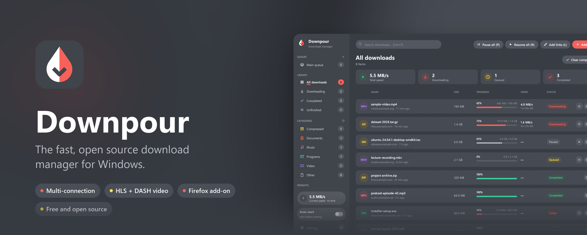
  </picture>
</p>

<p align="center">
  <a href="https://github.com/algometrix/downpour/releases/latest/download/Downpour-Setup.exe"></a>
  <a href="https://github.com/algometrix/downpour/releases/latest/download/downpour-firefox.xpi"></a>
</p>

<p align="center">
  <a href="https://github.com/algometrix/downpour/releases/latest"></a>
  <a href="https://github.com/algometrix/downpour/releases"></a>
  <a href="https://github.com/algometrix/downpour/actions/workflows/ci.yml"></a>
  <a href="LICENSE"></a>
  
  
  <a href="https://github.com/algometrix/downpour/stargazers"></a>
</p>

<p align="center">
  <a href="#-features"><b>Features</b></a> •
  <a href="#-install"><b>Install</b></a> •
  <a href="#-how-to-use"><b>How to use</b></a> •
  <a href="#-command-line"><b>Command line</b></a> •
  <a href="#-faq"><b>FAQ</b></a> •
  <a href="https://github.com/algometrix/downpour/issues/new/choose"><b>Report a bug</b></a>
</p>

<br>

<table>
  <tr>
    <td width="33%" valign="top">
      <h3>⚡ Faster downloads</h3>
      Up to 32 connections per file, with pause, resume, and recovery after a crash or a reboot.
    </td>
    <td width="33%" valign="top">
      <h3>🎬 Videos from any page</h3>
      Point at a video in Firefox and click <b>Download</b>. HLS and DASH streams become one MP4.
    </td>
    <td width="33%" valign="top">
      <h3>🪶 Small and private</h3>
      A native Rust app, no ads, no telemetry. Everything stays on your PC.
    </td>
  </tr>
</table>

## 🎞️ See it in action

<p align="center">
  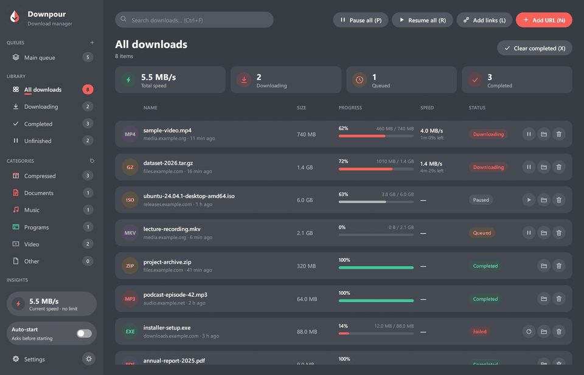
</p>

## ✨ Features

<table>
  <tr>
    <td width="50%" valign="top">

**⬇️ Downloading**

- **Several connections per file.** Each new connection takes half of the
  largest piece still left.
- **HLS and DASH video** joined into one MP4. Separate audio and video tracks
  are merged with ffmpeg when it is installed. AES-128 streams work.
- **Pick the quality**: 1080p, 720p and so on, or a default in Settings.
- **Pause and resume**, saved every 2 seconds. A resume checks that the file
  did not change on the server.
- **Speed limits**, for everything or one download.
- **Waits for disk space** instead of failing.
- **Refresh an expired link** from the page it came from.
- **Link checker**: paste many links, see which are online, add the ones you want.

</td>
    <td width="50%" valign="top">

**🗂️ Organizing**

- **Queues** that each run a set number of downloads at once.
- **Categories** with their own file types and folders.
- **Statistics**: per day, time of day, file type, category and site.
- **Search** with <kbd>Ctrl</kbd>+<kbd>F</kbd> and shortcuts for every main action.
- **10 color themes**, light and dark. The default matches the icon.

**🦊 Firefox add-on**

- **Takes over downloads** with their cookies, so sign-in protected files work.
- **A Download button on videos**, with a quality menu.
- **A media list** in the toolbar popup.
- **Right-click menu**: a link, a video, or every link on the page.
- **Private windows and containers** stay private.

</td>
  </tr>
  <tr>
    <td colspan="2" valign="top">

**🪟 Made for Windows**: per-user install with no admin rights • Start menu and desktop shortcuts • Settings > Apps entry • tray icon • Start with Windows • native notifications • progress on the taskbar button • keeps the PC awake while downloading • saves safely on shutdown • sharp on high-DPI screens • dark title bar

</td>
  </tr>
</table>

<p align="center">
  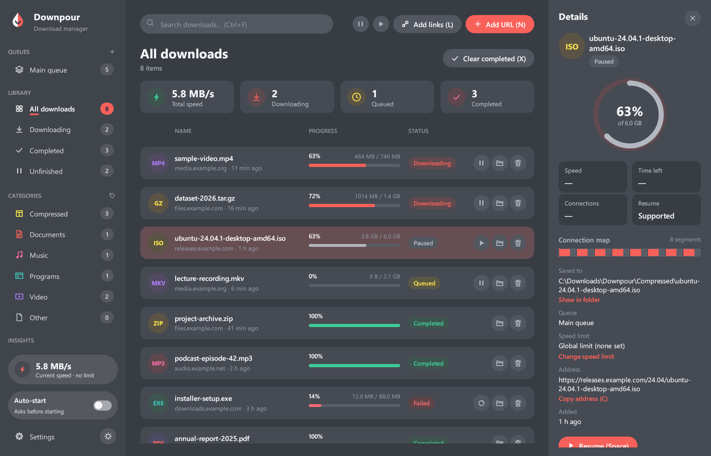
  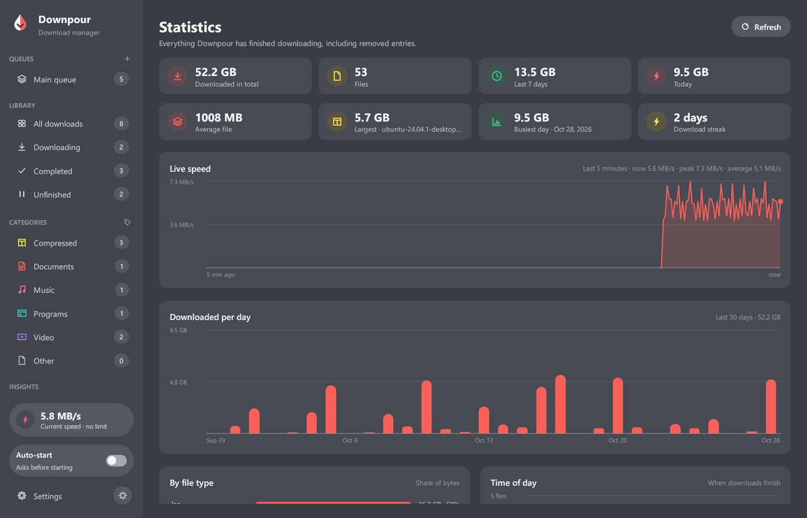
</p>
<p align="center">
  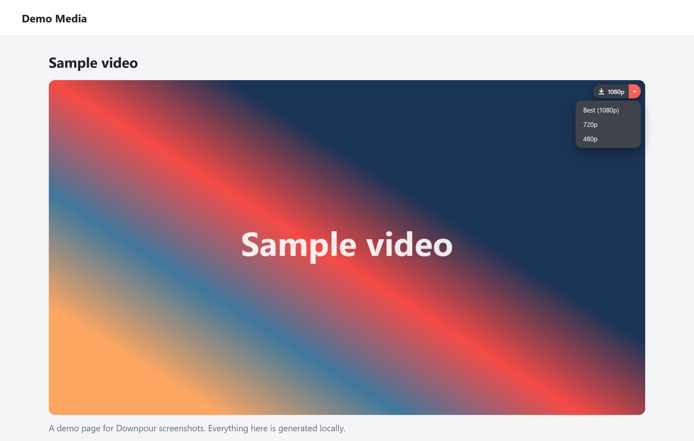
  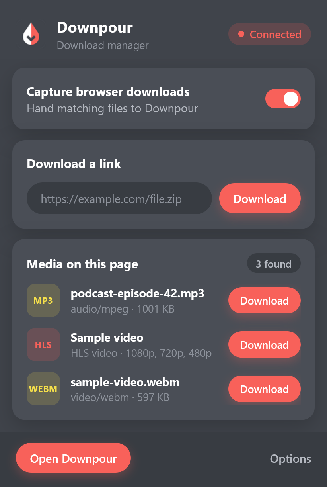
</p>

<p align="right"><a href="#top">Back to top ↑</a></p>

## 📦 Install

| | File | What it is |
| --- | --- | --- |
| 🪟 | [**Downpour-Setup.exe**](https://github.com/algometrix/downpour/releases/latest/download/Downpour-Setup.exe) | The app for Windows 10 and 11, 64-bit. |
| 🦊 | [**downpour-firefox.xpi**](https://github.com/algometrix/downpour/releases/latest/download/downpour-firefox.xpi) | The Firefox add-on (Firefox 115 or newer), signed by Mozilla. |
| 🔒 | [SHA256SUMS.txt](https://github.com/algometrix/downpour/releases/latest/download/SHA256SUMS.txt) | Checksums of both files. |

### 1. Install the app

1. Download and run **`Downpour-Setup.exe`**. It installs for your Windows
   account only, so it does not ask for administrator rights.
2. Choose the folder and the shortcuts, and click **Install**.

> [!NOTE]
> Windows may say **"Windows protected your PC"**, because the installer is not
> signed with a paid code-signing certificate. Click **More info**, then
> **Run anyway**. You can check the file against `SHA256SUMS.txt` first.

### 2. Add Downpour to Firefox

- **Easiest:** click **Add to Firefox** on the installer's last page, or later
  in the app under **Settings > Browser**.
- **By hand:** open `about:addons`, click the gear icon, choose
  **Install Add-on From File...**, and pick `downpour-firefox.xpi`.

> [!TIP]
> Click the Downpour icon in the Firefox toolbar. It should say **Connected**.
> If not, open the app once and check **Settings > Browser**.

<details>
<summary><b>Silent install for scripts</b></summary>

```powershell
Downpour-Setup.exe --quiet [--folder <absolute path>] [--no-shortcuts] [--no-browser-integration]
```

</details>

<p align="right"><a href="#top">Back to top ↑</a></p>

## 🚀 How to use

**Add a download**

- Click a download link in Firefox. Downpour takes it and asks where to save
  it, or starts it right away when **Auto-start** is on in the sidebar.
- Or click **Add URL** in the app and paste an address.
- Or click **Add links**, paste many addresses, check them, and add the ones
  you want.

**Download a video**

1. Open the page in Firefox and start playing the video.
2. Point at the video. A **Download** button appears at its top right.
3. Click it for the best quality, or click the arrow next to it to pick one.

The toolbar popup lists the videos and audio files found on the page too.

**Keyboard shortcuts**

| Anywhere in the list | | For the selected download | |
| --- | --- | --- | --- |
| Add URL | <kbd>N</kbd> | Pause, resume or retry | <kbd>Space</kbd> |
| Add links | <kbd>L</kbd> | Open the file | <kbd>Enter</kbd> |
| Pause all / Resume all | <kbd>P</kbd> / <kbd>R</kbd> | Show in folder | <kbd>O</kbd> |
| Start or stop the queue | <kbd>S</kbd> | Copy the address | <kbd>C</kbd> |
| Clear completed | <kbd>X</kbd> | Remove | <kbd>Del</kbd> |
| Search | <kbd>Ctrl</kbd>+<kbd>F</kbd> | Move up or down in the queue | <kbd>Ctrl</kbd>+<kbd>↑</kbd> / <kbd>↓</kbd> |
| Switch light and dark | <kbd>T</kbd> | Select the next or previous | <kbd>↓</kbd> / <kbd>↑</kbd> |

**Settings** (the gear at the bottom of the sidebar): the download folder,
connections per file, the default video quality, the theme, Start with
Windows, notifications, keeping the PC awake, and the browser integration.

<details>
<summary><b>More screenshots</b></summary>
<br>

| Settings | Light appearance |
| --- | --- |
| 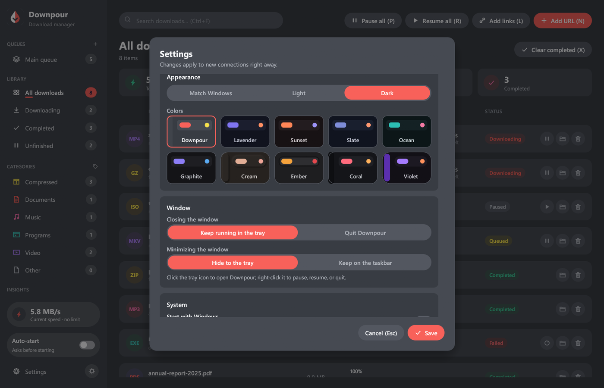 | 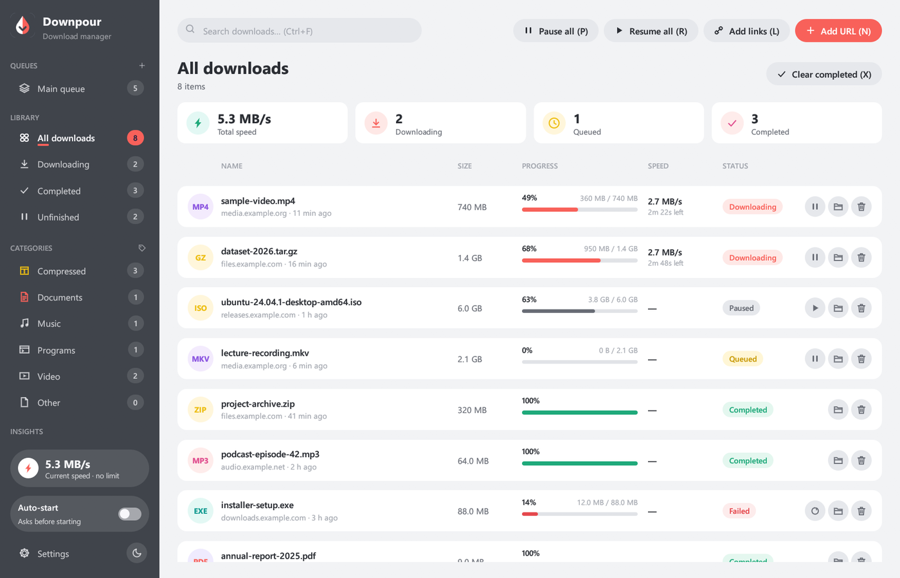 |
| **Windows settings** | **Add download** |
| 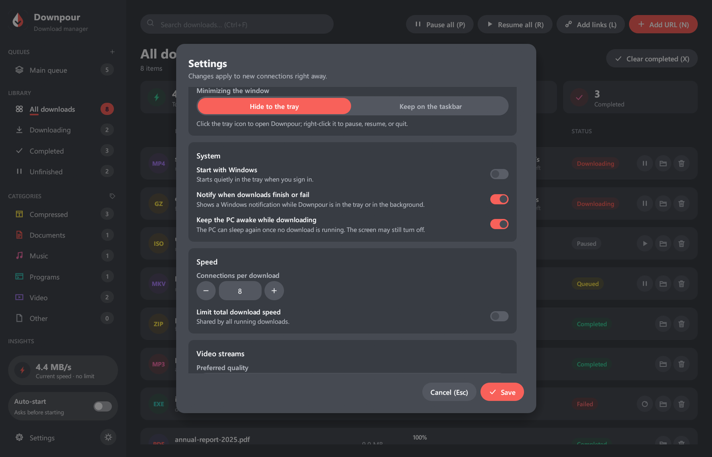 | 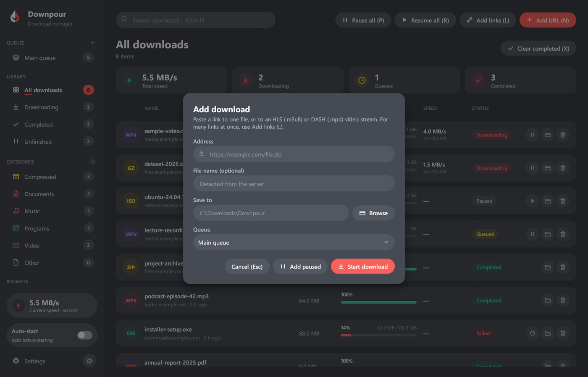 |
| **Notice when Downpour takes a download** | **Add-on options** |
| 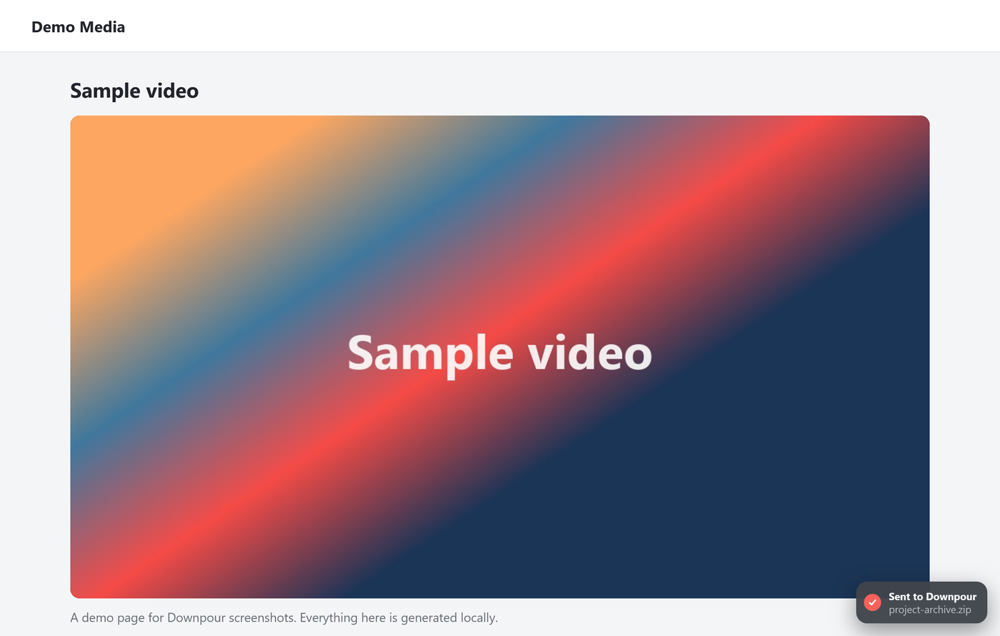 | 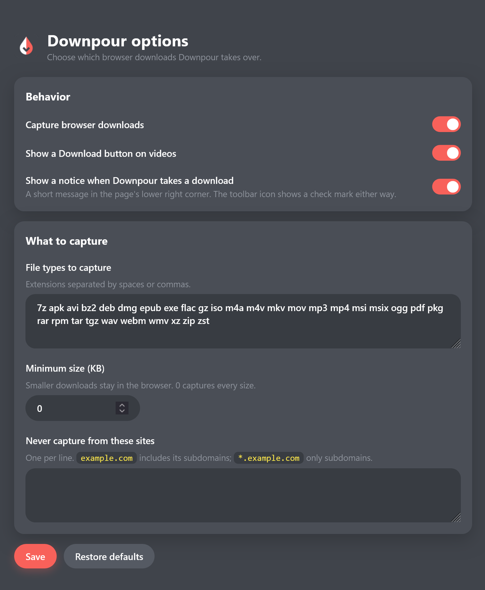 |

</details>

<p align="right"><a href="#top">Back to top ↑</a></p>

## 💻 Command line

The installer also puts `downpour-cli.exe` in the program folder.

```powershell
# Download in the terminal, with 8 connections
downpour-cli get https://example.com/file.iso -o "$HOME\Downloads"

# A video stream at 720p, limited to 2 MB/s
downpour-cli get https://example.com/video/master.m3u8 -q 720 -l 2M

# Read links from a file, 3 at a time
downpour-cli get -i links.txt -j 3

# Hand links to the running app instead
downpour-cli send https://example.com/file.zip
```

Run `downpour-cli get --help` for every option, including `--referer`,
`--cookie`, `--user-agent` and `--origin` for servers that need them.

## ❓ FAQ

<details>
<summary><b>Is it free?</b></summary>
<br>
Yes. Downpour is free and open source under the MIT license, with no ads and
no paid version.
</details>

<details>
<summary><b>Does it work with Chrome or Edge?</b></summary>
<br>
Not yet. The browser add-on is for Firefox only. You can still paste links
into the app or use <code>downpour-cli</code> from any browser.
</details>

<details>
<summary><b>Why can't it download some videos?</b></summary>
<br>
Videos protected with DRM cannot be downloaded, and live streams are not
supported yet. Also, the add-on only sees videos that the page loads after it
is running, so reload the page if a video is missing.
</details>

<details>
<summary><b>Does it send my data anywhere?</b></summary>
<br>
No. The add-on talks only to the Downpour app on your own PC, and there is no
telemetry. The download list keeps the cookies a download needs to resume,
and removing the download removes them. Logs leave out addresses and tokens.
</details>

<details>
<summary><b>Where are my downloads and settings?</b></summary>
<br>
Downloads go to <code>Downloads\Downpour\&lt;category&gt;</code> by default, and
each category can have its own folder. The download list, history and
settings are in <code>%LOCALAPPDATA%\Downpour\Downpour\data</code>.
</details>

<details>
<summary><b>Why does Windows warn about the installer?</b></summary>
<br>
SmartScreen warns about programs that are not signed with a paid code-signing
certificate and that few people have downloaded yet. Click <b>More info</b>,
then <b>Run anyway</b>. The source is all here, and the release lists SHA-256
checksums.
</details>

## 🧹 Uninstall

Use **Settings > Apps > Downpour > Uninstall**, **Start menu > Uninstall
Downpour**, or `Uninstall Downpour.exe` in the program folder.

It removes only what the installer added. **Your downloaded files are never
deleted.** Your download list and settings are kept unless you tick the box
to remove them too. To remove the add-on, open `about:addons` in Firefox.

## 🐞 Reporting bugs

Found a bug or have an idea? [Open an issue](https://github.com/algometrix/downpour/issues/new/choose).
The bug form asks for the Downpour, Windows and Firefox versions, the steps to
reproduce it, what you expected, and the lines from `downpour.log` in
`%LOCALAPPDATA%\Downpour\Downpour\data`.

> [!IMPORTANT]
> Please do not paste private download links, cookies or passwords. Replace
> them with something like `https://example.com/file.zip`.

## 🛠️ Building from source

You need Rust 1.88 or newer, the Windows SDK (for the icon and the app
manifest), and Node.js for the add-on tests.

```powershell
cargo build --release
cargo test --workspace
node --test extension/common/capture-rules.test.js
```

<details>
<summary><b>Build the installer and sign the add-on</b></summary>
<br>

```powershell
.\scripts\build-installer.ps1 -AmoCredentials <path\to\amo-keys.env>
```

`-AmoCredentials` signs the Firefox add-on through addons.mozilla.org on the
unlisted channel. The file holds your own `JWT_issuer=` and `JWT_secret=` API
keys, passed to `web-ext` through environment variables only. Mozilla accepts
each version once, so raise `version` in `extension/firefox/manifest.json`
for every new signing. Without the option, the last signed add-on is reused if
its version matches.

</details>

<details>
<summary><b>Project layout</b></summary>
<br>

```text
crates/
  downpour-core/      download engine: connections, HTTP, HLS/DASH, queues,
                      categories, disk space, history, link checking
  downpour-protocol/  messages shared by the app, the browser helper and the add-on
  downpour-app/       the desktop app (egui), downpour.exe
  downpour-host/      the browser helper (native messaging), downpour-host.exe
  downpour-cli/       the command line tool, downpour-cli.exe
  downpour-setup/     the installer and uninstaller, Downpour-Setup.exe
  downpour-build/     build-script helper: app manifest and version details
extension/
  common/             the add-on: background, popup, options, video button, rules
  firefox/            the Firefox manifest
scripts/              packaging, signing, installer, icon and README images
```

```text
Firefox add-on --native messaging--> downpour-host --127.0.0.1 + token--> downpour.exe
```

</details>

<details>
<summary><b>Development aids</b></summary>
<br>

- `DOWNPOUR_DATA_DIR=<folder>` (debug builds only) uses that folder instead of
  the real data folder, so tests never touch your downloads.
- `DOWNPOUR_SCREENSHOT=<file>` (debug builds only) lets a script drive the app
  and save frames. See `crates/downpour-app/src/ui/screenshot.rs`.
- `cargo run -p downpour-core --example fetch -- <url> <folder>` downloads one
  address with the engine and prints its progress.

</details>

## 🗺️ Not supported yet

FTP • proxy settings • a scheduler • live streams • multi-period DASH •
Chrome and Edge add-ons

## ⭐ Star history

<a href="https://star-history.com/#algometrix/downpour&Date">
  <picture>
    <source media="(prefers-color-scheme: dark)" srcset="https://api.star-history.com/svg?repos=algometrix/downpour&type=Date&theme=dark">
    
  </picture>
</a>

## 📄 License

Downpour is released under the [MIT License](LICENSE).

<p align="center">
  
  <br>
  <sub>If Downpour saves you time, a ⭐ helps others find it.</sub>
</p>

<p align="right"><a href="#top">Back to top ↑</a></p>
