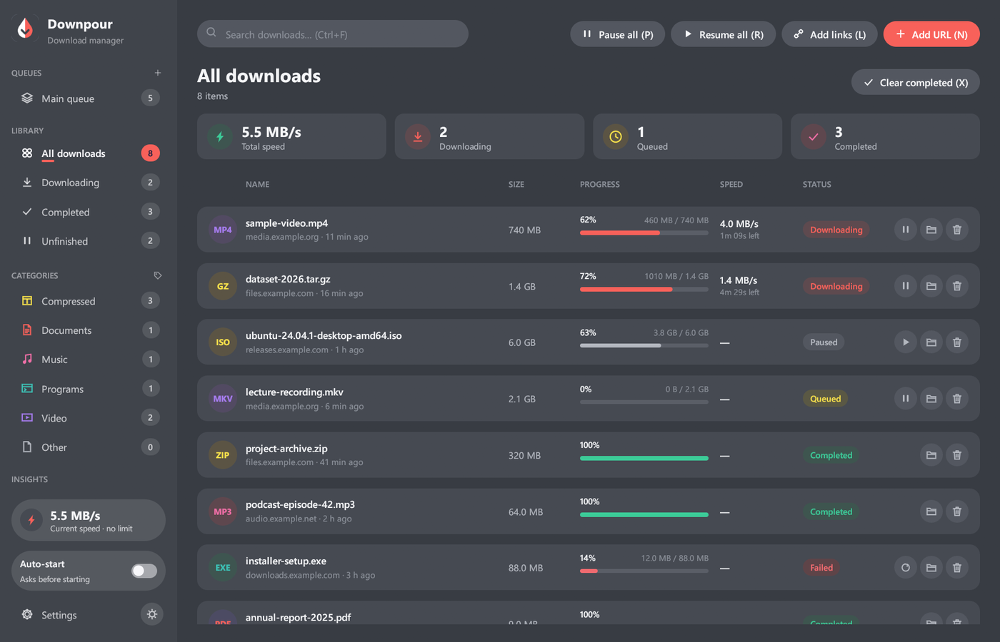

<p align="center">
  
</p>

<h1 align="center">Downpour</h1>

<p align="center">
  A fast, open source download manager for Windows, written in Rust, with a Firefox add-on.
</p>

<p align="center">
  <a href="https://github.com/algometrix/download_manager/releases/latest"></a>
  <a href="https://github.com/algometrix/download_manager/releases"></a>
  <a href="https://github.com/algometrix/download_manager/actions/workflows/ci.yml"></a>
  <a href="LICENSE"></a>
  
  
  
</p>



## Contents

- [Features](#features)
- [Install](#install)
- [How to use](#how-to-use)
- [Command line](#command-line)
- [Uninstall](#uninstall)
- [Reporting bugs](#reporting-bugs)
- [Building from source](#building-from-source)
- [Data and privacy](#data-and-privacy)

## Features

**Downloading**

- **Several connections per file.** A download starts on one connection and
  splits the largest remaining piece each time another connection joins, up
  to 32 per file.
- **Video streams (HLS and DASH).** Videos that a page plays from `.m3u8`
  playlists or `.mpd` manifests are downloaded piece by piece and joined into
  one MP4. Separate video and audio tracks are merged with ffmpeg if it is
  installed. Standard HLS AES-128 encryption works; DRM-protected video is
  detected and refused.
- **Quality choice.** Pick 1080p, 720p and so on per download, or set a
  default quality in Settings.
- **Pause, resume, crash recovery.** Progress is saved every 2 seconds. A
  resume checks that the file on the server has not changed.
- **Speed limits**, for everything or for one download.
- **Waits for disk space** instead of failing, and continues on its own once
  there is room.
- **Refresh an expired link.** Open the page the download came from, and the
  next link the browser sends replaces the old one.
- **Link checker.** Paste many links, see which ones are online and how big
  they are, then add the ones you want in one go.
- **Polite to servers.** When a server refuses extra connections, the download
  keeps only the ones it accepted.

**Organizing**

- **Queues.** The main queue and your own queues each run a set number of
  downloads at once.
- **Categories** with their own file types and save folders (Compressed,
  Documents, Music, Programs, Video, and your own).
- **Statistics:** total downloaded, downloads per day, time of day, and
  breakdowns by file type, category and site.
- **Search** with `Ctrl+F`, and keyboard shortcuts for the main actions.
- **10 color themes**, light and dark. The default Downpour theme matches the
  icon.

**Browser (Firefox)**

- **Takes over downloads** from Firefox, with their cookies and headers, so
  sign-in protected files work.
- **Download button on videos.** Point at a video and a Download button
  appears, with a menu of the qualities the stream offers.
- **Media list** in the toolbar popup with every video and audio file the page
  has loaded.
- **Right-click menu:** download a link, a video, or all links on a page.
- **Respects private windows and containers.**

**Windows**

- Installs per user, with no administrator rights.
- Start menu and desktop shortcuts, and an entry in Settings > Apps.
- Tray icon, and an optional **Start with Windows** (starts quietly in the tray).
- **Windows notifications** when a download finishes or fails.
- **Progress on the taskbar button.**
- **Keeps the PC awake** while downloading (can be turned off).
- Saves your downloads safely when Windows shuts down or you sign out.
- Sharp on high-DPI and multi-monitor setups; dark title bar in dark themes.

| Details | Statistics |
| --- | --- |
|  |  |
| **Video button in Firefox** | **Firefox toolbar popup** |
|  |  |

## Install

### 1. The app

1. Download **`Downpour-Setup.exe`** from the
   [latest release](https://github.com/algometrix/download_manager/releases/latest).
2. Run it. It installs for your Windows account only, so it does not ask for
   administrator rights.
3. Windows may show **"Windows protected your PC"**, because the installer is
   not signed with a paid code-signing certificate. Click **More info**, then
   **Run anyway**.
4. Choose the folder and shortcuts, and click **Install**.

### 2. The Firefox add-on

The add-on is signed by Mozilla, so Firefox installs it permanently.

- **Easiest:** on the installer's last page, click **Add to Firefox**. You can
  also do this later in the app under **Settings > Browser**.
- **By hand:** download **`downpour-firefox.xpi`** from the
  [latest release](https://github.com/algometrix/download_manager/releases/latest),
  open `about:addons` in Firefox, click the gear icon, choose
  **Install Add-on From File...**, and pick the file.

Click the Downpour icon in the Firefox toolbar. The popup should say
**Connected**. If it says the app is not set up, open the app once and check
**Settings > Browser**.

### Silent install

For scripts and deployment tools:

```powershell
Downpour-Setup.exe --quiet [--folder <absolute path>] [--no-shortcuts] [--no-browser-integration]
```

## How to use

**Add a download**

- Click a download link in Firefox. Downpour takes it and asks where to save
  it (or starts it right away when **Auto-start** is on in the sidebar).
- Or click **Add URL** (`N`) in the app and paste an address.
- Or click **Add links** (`L`), paste many addresses, check them, and add the
  ones you want.


**Download a video**

1. Open the page with the video in Firefox and start playing it.
2. Point at the video. A **Download** button appears at its top right.
3. Click it for the best quality, or click the arrow next to it to pick one.

The toolbar popup also lists the videos and audio files found on the page.
If a page plays its video in a way the add-on cannot see (for example DRM),
nothing is listed.

**Manage downloads**

- Pause, resume, open, or show a file in its folder from the buttons on each
  row, or right-click a row for more.
- Select a row to see its details: speed, time left, connections, and where it
  is saved.
- Use queues to decide what runs and how many at once, and the speed card at
  the bottom of the sidebar to set a speed limit.

**Settings**

The gear at the bottom of the sidebar opens Settings: the download folder,
connections per file, the default video quality, the theme, Start with
Windows, notifications, keeping the PC awake, and the browser integration.


<details>
<summary>More screenshots</summary>

| Light appearance | Windows settings |
| --- | --- |
|  |  |
| **Notice when Downpour takes a download** | **Add-on options** |
|  |  |

</details>

## Command line

The installer also adds `downpour-cli.exe` to the program folder.

```powershell
# Download in the terminal, 8 connections, into the Downloads folder
downpour-cli get https://example.com/file.iso -o "$HOME\Downloads"

# A video stream at 720p, with a speed limit of 2 MB/s
downpour-cli get https://example.com/video/master.m3u8 -q 720 -l 2M

# Read links from a file, 3 at a time
downpour-cli get -i links.txt -j 3

# Hand links to the running Downpour app instead
downpour-cli send https://example.com/file.zip
```

Run `downpour-cli get --help` for every option, including `--referer`,
`--cookie`, `--user-agent` and `--origin` for servers that need them.

## Uninstall

Use any of these:

- **Settings > Apps > Installed apps > Downpour > Uninstall**
- **Start menu > Uninstall Downpour**
- `Uninstall Downpour.exe` in the program folder

The uninstaller removes only what the installer added: its own files, the
shortcuts, the Firefox integration, Start with Windows, and the Apps entry.
**Your downloaded files are never deleted.** Your download list and settings
are kept, unless you tick the box to remove them too.

To remove the add-on, open `about:addons` in Firefox and remove Downpour.

Silent uninstall:

```powershell
"Uninstall Downpour.exe" --quiet
```

## Reporting bugs

Found a bug or have an idea? Please
[open an issue](https://github.com/algometrix/download_manager/issues/new/choose).
The bug form asks for:

- the Downpour, Windows and Firefox versions,
- the steps to reproduce it,
- what you expected and what happened instead,
- the relevant lines from the log file, `downpour.log` in
  `%LOCALAPPDATA%\Downpour\Downpour\data`.

Please do not paste private download links, cookies or passwords. Replace them
with something like `https://example.com/file.zip`.

## Building from source

You need Rust 1.88 or newer, the Windows SDK (its `rc.exe` embeds the icon and
the app manifest), and Node.js for the add-on tests.

```powershell
cargo build --release
cargo test --workspace
node --test extension/common/capture-rules.test.js
```

Build the installer (writes `dist\Downpour-Setup.exe`):

```powershell
.\scripts\build-installer.ps1 -AmoCredentials <path\to\amo-keys.env>
```

`-AmoCredentials` signs the Firefox add-on through addons.mozilla.org on the
unlisted channel. The file holds your own `JWT_issuer=` and `JWT_secret=` API
keys; they are passed to `web-ext` through environment variables only. Mozilla
accepts each version once, so raise `version` in
`extension/firefox/manifest.json` for every new signing. Without the option,
the last signed add-on is reused if its version matches.

<details>
<summary>Project layout</summary>

```text
crates/
  downpour-core/      download engine: connections, HTTP, HLS/DASH, queues,
                      categories, disk space, history, link checking
  downpour-protocol/  messages shared by the app, the browser helper and the add-on
  downpour-app/       the desktop app (egui), downpour.exe
  downpour-host/      the browser helper (native messaging), downpour-host.exe
  downpour-cli/       the command line tool, downpour-cli.exe
  downpour-setup/     the installer and uninstaller, Downpour-Setup.exe
  downpour-build/     build-script helper: app manifest and version details
extension/
  common/             the add-on: background, popup, options, video button, rules
  firefox/            the Firefox manifest
scripts/              packaging, signing, installer and icon generation
assets/               program icon
```

How the pieces talk:

```text
Firefox add-on --native messaging--> downpour-host --127.0.0.1 + token--> downpour.exe
```

</details>

<details>
<summary>Development aids</summary>

- `DOWNPOUR_DATA_DIR=<folder>` (debug builds only) uses that folder instead of
  the real data folder, so tests and UI reviews never touch your downloads.
- `DOWNPOUR_SCREENSHOT=<file>` (debug builds only): writing `<file>.request`
  makes the app run the commands in it and save the next frame. See
  `crates/downpour-app/src/ui/screenshot.rs`.
- `cargo run -p downpour-core --example fetch -- <url> <folder>` downloads one
  address with the engine and prints its progress.

</details>

## Data and privacy

- Downloads go to `Downloads\Downpour\<category>` by default. Each category can
  have its own folder.
- The download list, queues, history and settings are files in
  `%LOCALAPPDATA%\Downpour\Downpour\data`. Each entry keeps the cookies and
  headers the browser sent with it, because resuming needs them. Removing a
  download removes them.
- The add-on talks only to the Downpour app on your own PC. Nothing is sent
  anywhere else, and there is no telemetry.
- Logs leave out download addresses and tokens.

## Not supported yet

FTP, proxy settings, a scheduler, live streams, and multi-period DASH.

## License

[MIT](LICENSE)
